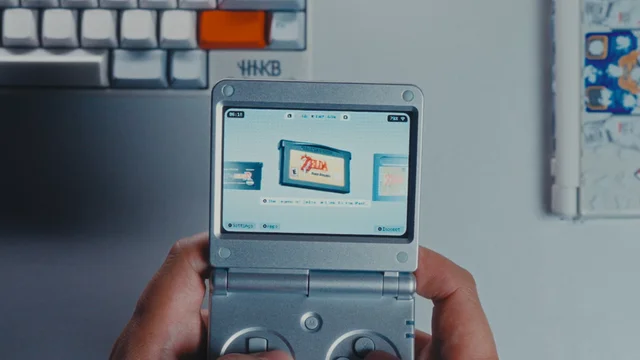

# Socket for the RG SP

<p align="center">
  
</p>

Bring the [Socket](https://www.patreon.com/cw/SocketLauncher) game launcher
to your **Anbernic RG SP** with
[BaseOS](https://github.com/pvaibhav/BaseOS). Heavily inspired by [Slot](https://github.com/BrandonKowalski/slot).

This port is built and tested for the RG SP. Other Anbernic H700 devices may
work, but are untested. Rotated panels, such as the RG28XX, are not supported.
Only GB, GBC and GBA are supported. Other systems may work, but are untested.

> [!IMPORTANT]
> This repository contains no Socket code or assets. You'll need your own
> Socket APK. The build reads it locally on your computer and creates the card
> files. Do not share the `dist/` folder, because `socket.pck` contains
> Socket.

This project is not affiliated with or endorsed by the Socket developers.

## Requirements

- An RG SP with BaseOS on the card in slot TF1.
- A Socket APK, version 0.8.0 or 0.3.2. Version 0.3.2 is the last free
  version. See [Socket versions](docs/socket-versions.md).
- A macOS or Linux computer with Docker (AArch64 Linux containers), a C
  compiler, OpenSSL libcrypto, Python 3, zstd, unzip and patch.
- An AArch64 Linux libretro core for each platform, for example
  `mgba_libretro.so`.

## Build

1. Point the build at your APK:

   ```sh
   ./build.sh ~/Downloads/socket_release_0.8.0.apk
   ```

2. Your card files will be in `dist/`.

The first build compiles Godot and RetroArch. Expect it to take a while.

## Install

1. If BaseOS is not installed, follow the [BaseOS installation
   guide](https://github.com/pvaibhav/BaseOS/blob/main/INSTALL.md) to install
   it on the card for slot TF1. Back up the card first: flashing erases it.
2. Turn off your RG SP and put its BaseOS card in your computer.
3. If the card has another frontend, back up its
   `System/launch_frontend.sh`. The next step will overwrite it.
4. Copy the contents of `dist/` to the root of the card.
5. Copy your libretro cores to `System/socket/cores/`.
6. Put your games in `Games/GB`, `Games/GBC` and `Games/GBA`. Create each
   folder that you plan to use, even if it is empty.
7. Prepare the library on a Mac before the first boot. See [Prepare the
   library](#prepare-the-library-macos-only).
8. Eject the card. Put it in slot TF1 and turn on the RG SP.

BaseOS has no Wi-Fi support. Prepare the emulator lists and game library
on your computer before you use Socket. Download metadata and artwork on
your computer if you want them. Socket does not download this data on the
RG SP.

After this setup, you can scan new ROMs for the prepared platforms on the
RG SP with Socket's platform editor. Pick a ROM folder and a RetroArch
emulator, then select **Scan**.
Socket shows only emulators that have a core in `System/socket/cores/`.
An on-device scan uses cached media. It does not download missing media.

## Prepare the library (macOS only)

`tools/setup-card.py` adds the GB, GBC and GBA platforms for the `Games/`
folders. It scans unpacked `.gb`, `.gbc` and `.gba` files. If the card has
Slot's mGBA or gpSP core in `System/`, the tool copies it to
`System/socket/cores/`.
This preparation is a required installation step. Repeat it on your
computer when you add games and want their metadata and artwork.

Missing metadata or artwork does not hide games from the homescreen.
Socket uses the ROM file name without its extension when metadata is missing and
shows a cartridge without downloaded artwork. The library and emulator
records must still be on the card.

1. Turn off the RG SP. Mount its card on the Mac.
2. Preview the changes without writing anything:

   ```sh
   python3 tools/setup-card.py --dry-run /Volumes/BASEOS
   ```

3. Prepare the library, metadata and artwork with your own Socket APK:

   ```sh
   python3 tools/setup-card-from-apk.py ~/Downloads/socket_release_0.8.0.apk /Volumes/BASEOS
   ```

   You can also explicitly set `SOCKET_API_KEY` to an authorized Socket GamesDB key
   (this is specific to Socket, not a standard GamesDB key), then run:

   ```sh
   python3 tools/setup-card.py /Volumes/BASEOS
   ```

   If you want to avoid scraping, prepare the library without downloads.
   This command needs no API key or network access. After you run it, games
   without cached metadata or artwork will still appear on the homescreen:

   ```sh
   python3 tools/setup-card.py --scan-only /Volumes/BASEOS
   ```

4. Check the report before you eject the card. Confirm that `scanned`
   includes your games and resolve entries in `failures`. Entries in
   `unmatched` have no service match. These games still appear without
   downloaded media.

Before replacing a file, the tool backs it up as `<file>.bak-<time>`. To
restore a file, copy its backup over it. To pick up interrupted downloads,
run the command again. Downloads need `curl` 8.4 or later.

## Controls

| Control | Action |
|---------|--------|
| Volume buttons | Change the volume in steps of 5. Socket and games use the same level. |
| SELECT + Up or Down | Change the brightness. |
| SELECT + Left or Right | Change the screen temperature. Right makes the screen warmer. |
| POWER, or close the lid | Sleep. In a game, the device first saves a resume state. |
| Hold POWER for 1 second | Shut down. In a game, the device first saves a resume state. |
| MENU (in a game) | Open the game menu: save and load states, settings, and Save & Exit. |
| Hold MENU for 1 second (in a game) | Save a state and go back to Socket. |
| Hold L2 or R2 (in a game) | Rewind or fast-forward. |

After three minutes of sleep, the device shuts down. After a shutdown in a
game, Socket opens that game again at the next start. For the details, see
[Controls, sleep and power](docs/controls.md).

## Troubleshooting

Look in the card's `Logs` folder:

- `socket.log`: Socket
- `socket-game.log`: RetroArch and game start
- `socket-hardware.log`: buttons, sleep and power

If the build stops at `patch-socket`, your APK uses an unsupported Socket
version.

## More information

See [docs](docs/README.md) for how the port works, RetroArch settings,
rendering changes and development.

## License

This project uses the GNU General Public License, version 3 or later. See
[LICENSE](LICENSE). It contains code from Godot, RetroArch, Slot and Nerd
Fonts. See [Licenses](docs/licenses.md).

Socket is not covered by this license.
